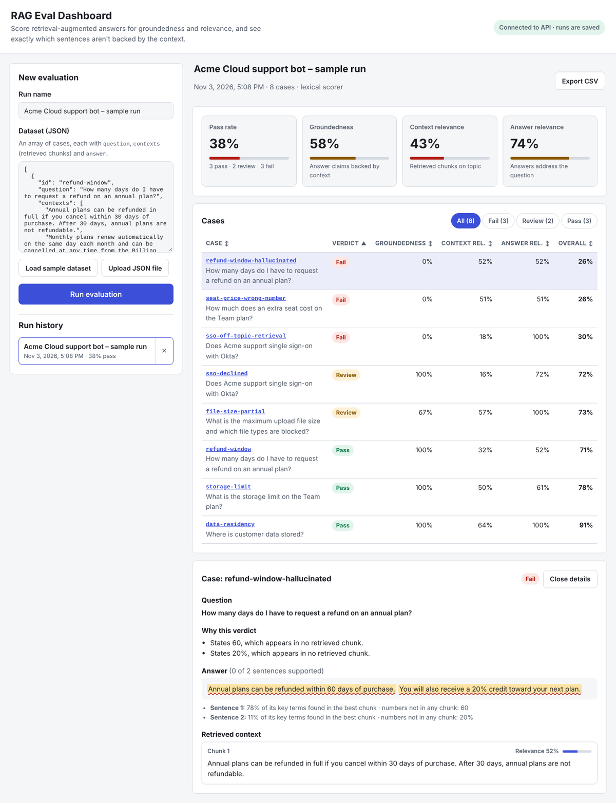

# RAG Eval Dashboard

A full-stack tool for evaluating **retrieval-augmented generation (RAG)** systems. Paste or upload your bot's questions, the chunks it retrieved, and the answers it gave. The dashboard scores every answer for **groundedness**, **context relevance** and **answer relevance**, and shows exactly which sentences aren't backed by the retrieved context, including invented numbers like a wrong price or refund window.

**[Live demo →](https://shriya2002.github.io/rag-eval-dashboard/)** (runs fully in your browser; click *Load sample dataset*, then *Run evaluation*)




## Why

A RAG bot can sound confident while making things up. The two failures that matter most in production are:

1. **Bad retrieval:** the retriever fetched chunks unrelated to the question, so the model had nothing real to work from.
2. **Hallucination:** the retriever did its job, but the answer adds claims, often numbers, that the chunks don't contain.

This dashboard catches both, case by case, so you can compare runs before and after a prompt, chunking or retriever change.

## What it measures

| Metric | Question it answers | How it's computed |
| --- | --- | --- |
| **Context relevance** | Did the retriever fetch chunks about the question? | For each chunk, the IDF-weighted share of the question's key terms it contains; averaged over chunks, so off-topic chunks pull the score down |
| **Answer relevance** | Does the answer address the question? | IDF-weighted share of the question's key terms present in the answer |
| **Groundedness** | Is every claim backed by the context? | Each answer sentence is matched against its best chunk. A sentence is supported only if enough of its key terms appear there **and** every number in it (prices, days, percentages) appears in some chunk |

**Overall** = 50% groundedness + 25% context relevance + 25% answer relevance. A case **fails** if groundedness is under 50%, **passes** if overall ≥ 70% and groundedness ≥ 80%, and otherwise goes to **review**. Answers where the model declines ("I couldn't find that…") always go to review, because a person should confirm the information really was missing. All thresholds can be overridden per run.

### Lexical baseline + optional LLM judge

The built-in scorer is lexical: fast, deterministic, free, and it needs no API key, which makes it good for CI regression checks. Its limit is paraphrase: it can't tell that "cancel within a month" and "30 days" mean the same thing.

Set `ANTHROPIC_API_KEY` and the server also asks an LLM judge (Claude, via the Anthropic Messages API) to grade each case. Judge scores are averaged with the lexical scores and its explanation is shown on the case. If the judge call fails or times out, that case falls back to lexical scoring instead of failing the run.

## Architecture

```
src/
  core/      Pure TypeScript scoring, validation and types. No dependencies, shared by server and browser.
  server/    Node.js HTTP API (no framework), JSON-file run store, optional LLM judge
  web/       React + TypeScript dashboard (bundled with esbuild)
tests/       Unit and API tests (node:test)
e2e/         Playwright browser tests
```

- **One scoring engine, two places.** `src/core` runs on the server for saved runs and in the browser for demo mode, so results are identical either way.
- **Demo mode.** On startup the UI calls `GET api/health`. If no server answers (as on GitHub Pages), it scores in the browser and keeps runs in memory.
- **Safe persistence.** `JsonFileStore` writes to a temp file and renames it over the original, and serializes writes, so a crash or concurrent requests can't corrupt saved runs. The `RunStore` interface makes it easy to swap in a database.
- **Bounded concurrency.** LLM judge calls run at most four at a time, with timeouts.
- **Accessibility.** Sortable table headers expose `aria-sort`, the filter is a real radio group, unsupported sentences are marked for screen readers (not only by color), and focus moves to results and case details when they open.

## API

| Method | Path | Description |
| --- | --- | --- |
| `GET` | `/api/health` | `{ ok, scorer }`, where scorer is `lexical` or `lexical+llm` |
| `GET` | `/api/runs` | Saved runs (summary only), newest first |
| `POST` | `/api/runs` | Body `{ name?, cases, thresholds? }`. Evaluates, saves and returns the full run |
| `GET` | `/api/runs/:id` | Full run with per-case, per-sentence results |
| `DELETE` | `/api/runs/:id` | Deletes a run |

Bad input gets a `400` with a message naming the broken case (for example `Case 3 needs "contexts" as an array of strings.`); bodies over 2 MB get a `413`.

### Dataset format

```json
[
  {
    "id": "refund-window",
    "question": "How many days do I have to request a refund on an annual plan?",
    "contexts": ["Annual plans can be refunded in full if you cancel within 30 days of purchase."],
    "answer": "You can get a full refund if you cancel within 30 days of purchase."
  }
]
```

See [`sample-data/acme-support-bot.json`](sample-data/acme-support-bot.json) for an 8-case example covering a correct answer, invented numbers, off-topic retrieval, a partly grounded answer and a model that declines to answer.

## Run it locally

Requires Node.js 18.18 or newer (22 recommended).

```bash
npm install
npm run dev                 # builds the UI and starts http://localhost:8787
ANTHROPIC_API_KEY=... npm run dev   # optional: add the LLM judge
```

Runs are saved to `data/runs.json` (set `DATA_FILE` to change it, `PORT` to change the port, `JUDGE_MODEL` to pick the judge model).

## Tests

```bash
npm test                    # 24 unit + API tests (scoring, validation, HTTP routes, judge parsing, persistence)
npx playwright install chromium
npm run test:e2e            # 6 browser tests (full flow, filtering, sorting, persistence, errors, demo mode)
npm run typecheck
```

CI runs all of these on every push and pull request.

## Roadmap

- Embedding-based similarity as a middle ground between lexical and LLM scoring
- Run-to-run comparison view (what got better or worse after a change)
- Import directly from LangChain / LlamaIndex trace exports

## License

MIT
